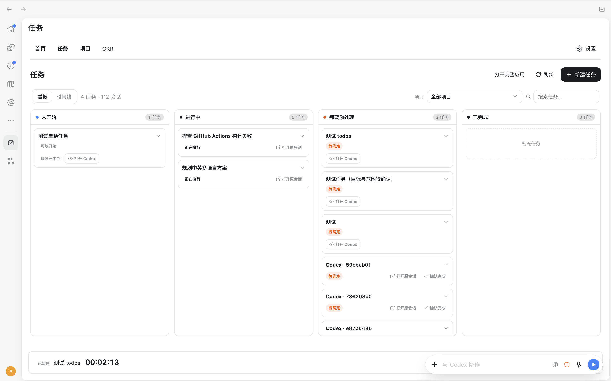
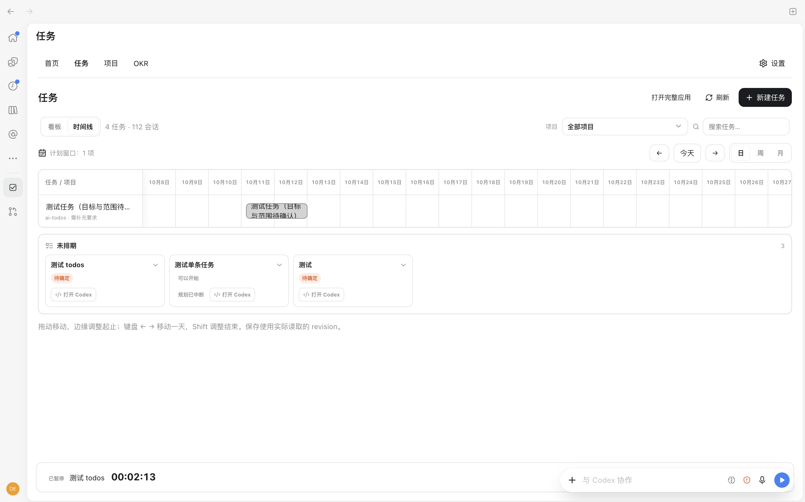

# Todos · 任务

[English](README.md) | 简体中文

面向 Codex 的任务与专注工作台。在一个地方管理任务、项目、OKR 和每日计划，记录专注时间，审阅 AI 交付。数据通过 SQLite 保存在本地。

## 为什么需要 Todos？

并行执行多个 Codex 任务时，需要在不同会话之间来回切换，逐个查看状态。缺少一个统一视图，无法一眼看到哪些会话正在运行、等待输入，哪些结果需要审阅。

Todos 将会话状态和任务进度集中到一个看板，方便你查看全局进展，找到需要处理的事项，无需逐个打开会话。无法观察到的运行状态会标为未知。

## 界面预览

### 任务与会话看板



### 时间线



## 安装

需要支持插件的 Codex CLI 和桌面端、Git，以及 **Node.js 24+**。确保 Codex 启动环境的 PATH 能找到 `node` 和 `codex`。

```sh
codex plugin marketplace add denvey/ai-todos
codex plugin add ai-todos@ai-todos
```

插件已预构建，安装无需运行 npm 或编译。

安装后开启新会话，输入 **“打开 ai-todos 工作台”**。如果客户端没有显示工作台，打开工具返回的本地 `browserUrl`。

### 审阅并信任 8 个生命周期钩子

插件会自动注册 **8 个钩子**，每种事件一个。安装或启用插件不会自动信任它们。要完整接收钩子提供的实时状态：

1. 在终端运行 `codex` 并打开 `/hooks`，或打开 Codex 桌面端的钩子设置。
2. 找到来源为 **ai-todos** 的钩子，对照下表审阅全部 8 个，然后勾选启用并信任。
3. 保存选择。无需再向全局配置手动添加同一组钩子。

| 钩子事件 | ai-todos 的用途 |
| --- | --- |
| `SessionStart` | 记录会话处于空闲状态，并向 AI 提供可信会话 ID 和已关联的任务 ID。 |
| `UserPromptSubmit` | 将会话标为运行中，并为新一轮提供会话和关联任务上下文。 |
| `PreToolUse` | 工具调用前刷新运行状态。 |
| `PostToolUse` | 工具调用后刷新运行状态，此时 AI 本轮工作可能仍在继续。 |
| `PermissionRequest` | 将会话标为等待授权；不自动批准或拒绝请求。 |
| `Stop` | 将本轮标为空闲；不代表业务任务完成或验收通过。 |
| `Interrupt` | 记录本轮被用户中断。 |
| `SessionEnd` | 记录会话结束；不代表业务任务验收通过。 |

这 8 个钩子调用同一个本地 `hooks/observe.js` 脚本，超时均为 3 秒。脚本将会话标识、工作目录、事件、轮次 ID、活动时间和观察状态写入本地 SQLite，不保存提示词正文或工具输入／输出内容。会话活动观察与任务交付、人工验收分别记录。

未信任时，Codex 会跳过这些钩子。任务管理和历史会话同步仍可使用，但无法接收钩子提供的实时更新。规则见官方 [Codex 钩子信任说明](https://learn.chatgpt.com/docs/hooks#review-and-trust-hooks)。

## 更新

```sh
codex plugin marketplace upgrade ai-todos
codex plugin add ai-todos@ai-todos
```

更新后开启新会话并重新打开工作台。若仍加载旧界面，重启 Codex。

后续保持使用同一插件来源 `ai-todos@ai-todos`。钩子设置可能显示 `.../0.1.10/hooks/observe.js` 这样的版本缓存路径；实际定义使用 `${PLUGIN_ROOT}`，Codex 加载插件时会自动指向安装版本，无需手动修改路径。来源和钩子定义不变时，仅升级版本无需重新信任这 8 个钩子。若 Codex 将钩子标为新建或已修改，应重新审阅并信任当前定义；切换市场来源也会产生新的信任标识。

## 使用

- **首页**：快捷录入任务并安排今天。Enter 加入今天，Option/Alt + Enter 存入收件箱。
- **收件箱**：收集想法，预览 AI 整理建议，再转为任务。
- **任务**：说明与验收标准可选填；设置优先级与排期，通过看板或时间线跟踪进展。点击**确认完成**，将已停止的任务移到**已完成**并关闭弹窗。已提交的交付继续通过审阅证据验收。
- **Codex 会话**：打开任务关联的会话，或创建预填任务信息的新会话。准备好后，在 Codex 中发送提示继续工作。
- **项目与 OKR**：按项目组织任务，跟踪目标和关键结果。
- **专注**：开始、暂停、恢复或结束计时。运行中的计时会持续到你暂停或结束，包括设备休眠或关闭 Codex 的时间。
- **审阅**：查看交付摘要和证据，人工验收或退回修改。AI 停止不等于任务完成或验收通过。
- **设置**：选择跟随系统、简体中文或 English，并配置提醒与时区。语言切换立即生效，用户内容保留原文。

浏览器通知需要授权且页面保持打开。服务停止或设备休眠期间暂停提醒调度；提醒不会自动执行 AI 任务。

## 从源码运行

需要 Node.js 24+ 和 npm。

```sh
git clone https://github.com/denvey/ai-todos.git
cd ai-todos
npm ci
npm run package:plugin
npm run open
```

启动本地服务并打开 `http://127.0.0.1:16943`。首次打开为空工作台。在源码目录运行 `npm run stop` 可停止服务。

## 发版

每次推送到 `main` 都会运行发版 workflow：自动递增 patch 版本，使用 Node.js 24 构建便携插件，将版本号和预构建插件提交回 `main`，然后创建 `v<版本号>` GitHub Release，附带 `.zip`、`.tar.gz` 安装包和自动生成的发布说明。发版提交使用 `GITHUB_TOKEN`，不会再次触发发版。并发合并按最新的 `main` 构建，可能合并为一次发版。

workflow 需要 `contents: write` 权限；仓库规则须允许 `github-actions[bot]` 向 `main` 推送发版提交。如果构建期间 `main` 收到新提交，原子推送会失败且不会覆盖它，重新运行 workflow 即可。重跑已打 tag 的版本会复用版本号并重新上传安装包。也可在 Actions 页选择 **Release**，在 `main` 上手动运行。

## 本地数据

数据库位于 `~/.ai-todos/ai-todos.sqlite`。服务仅监听 `127.0.0.1`。卸载插件不会删除数据，也不会停止服务。

| 环境变量 | 默认值 | 用途 |
| --- | --- | --- |
| `AI_TODOS_DATA_DIR` | `~/.ai-todos` | 数据目录 |
| `AI_TODOS_PORT` | `16943` | 本地 HTTP 端口 |

服务、MCP 和 hooks 应使用相同配置。备份或恢复数据库前，先停止服务并确保 hooks 已停止写入。
